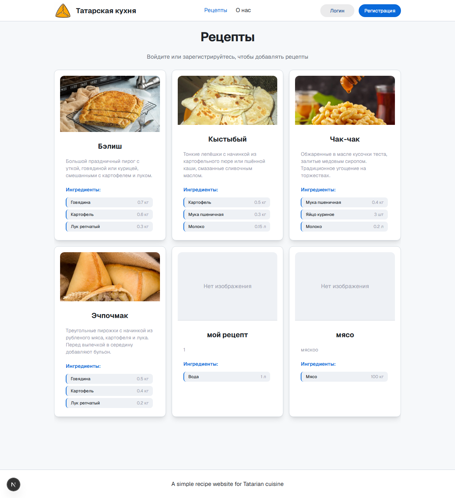

# Татарская кухня 🍲

[](https://github.com/Vxstxrg/Tatarina-Kitchen/actions/workflows/ci.yml)

Учебный fullstack-проект: сайт рецептов татарской кухни с авторизацией, каталогом
ингредиентов и конструктором рецептов.



## Стек

- **Next.js 16** (App Router, Server Actions) + **React 19** + **TypeScript**
- **Prisma 7** + **PostgreSQL** (через драйверный адаптер `@prisma/adapter-pg` или Prisma Accelerate)
- **Auth.js (next-auth v5)** — вход по email/паролю, JWT-сессии, хеширование bcrypt
- **Zod** — единые схемы валидации на клиенте и сервере
- **Zustand** — клиентское состояние
- **HeroUI v3** + **Tailwind CSS 4** — UI-кит и стили
- **Vitest** — юнит-тесты

## Возможности

- 🔐 Регистрация и вход по email/паролю; гостям рецепты доступны только для чтения
- 👤 **Владение рецептами**: редактировать и удалять рецепт может только его автор — проверяется на сервере
- 📖 Каталог рецептов с картинками, описанием и составом
- ➕ Создание рецепта: до 10 ингредиентов из справочника с указанием количества
- ✏️ Редактирование и удаление своих рецептов
- 🥕 Справочник ингредиентов: категории, единицы измерения, цена за единицу
- 🛡️ Все мутации на сервере проверяют сессию и права, данные валидируются через Zod —
  скрытие кнопок в UI носит только косметический характер
- 🩺 Health-check: `GET /api/health` (проверяет доступность БД)

## Запуск

Требуется Node.js 20+.

```bash
# 1. Установить зависимости
npm install

# 2. Создать .env по образцу
cp .env.example .env
# заполнить DATABASE_URL и AUTH_SECRET

# 3. Сгенерировать Prisma-клиент и применить схему к БД
npx prisma generate
npx prisma db push

# 4. Наполнить базу демо-данными (ингредиенты и рецепты татарской кухни)
npm run db:seed

# 5. Запустить dev-сервер
npm run dev
```

Приложение: <http://localhost:3000>

### Запуск через Docker

Альтернатива без локального Node/Postgres — поднимает приложение и базу PostgreSQL:

```bash
docker compose up --build
```

Приложение: <http://localhost:3100> (порт хоста меняется через `APP_PORT=3000 docker compose up`).
Postgres доступен с хоста на порту 5433 (postgres/postgres). В контейнере приложение
использует локальную базу из compose вместо Prisma Accelerate.

### Деплой на Vercel

1. Импортируйте репозиторий в [Vercel](https://vercel.com/new).
2. Задайте переменные окружения в настройках проекта:
   - `DATABASE_URL` — строка подключения (Prisma Accelerate, Neon или другая Postgres-БД);
   - `AUTH_SECRET` — секрет сессий, сгенерируйте `openssl rand -base64 32`.
3. Примените схему и демо-данные к облачной БД один раз с локальной машины:
   `DATABASE_URL=<строка> npx prisma db push && DATABASE_URL=<строка> npm run db:seed`.

CI (lint + typecheck + тесты + сборка) запускается автоматически на каждый пуш в `main`
и на каждый pull request.

## Скрипты

| Команда             | Действие                            |
| ------------------- | ----------------------------------- |
| `npm run dev`       | Dev-сервер                          |
| `npm run build`     | Prisma generate + production-сборка |
| `npm run start`     | Запуск production-сборки            |
| `npm run lint`      | ESLint                              |
| `npm run typecheck` | Проверка типов TypeScript           |
| `npm run test`      | Юнит-тесты (Vitest)                 |
| `npm run db:seed`   | Наполнение БД демо-данными          |

## Структура проекта

```
prisma/            схема БД (User, Ingredient, Recipe, RecipeIngredient)
src/
  actions/         серверные экшены (CRUD рецептов/ингредиентов, auth)
  app/             маршруты App Router: (public), (protected), api
  auth/            конфигурация Auth.js
  components/      UI- и обычные компоненты
  config/          настройки сайта и layout
  constants/       опции селектов (категории, единицы)
  forms/           формы (логин, регистрация, рецепт, ингредиент)
  generated/       сгенерированный Prisma-клиент (не редактировать)
  schema/          zod-схемы валидации + тесты
  store/           zustand-сторы
  types/           общие типы
  utils/           prisma-клиент, пароль, auth-guard + тесты
```

## Безопасность

- Пароли хранятся как bcrypt-хеши (10 раундов)
- Рецепты привязаны к автору: `updateRecipe`/`deleteRecipe` проверяют на сервере,
  что текущий пользователь — владелец рецепта
- Серверные экшены мутаций (`createRecipe`, `updateRecipe`, `deleteRecipe`,
  `createIngredient`, `deleteIngredient`) отклоняют запросы без сессии
- Входные данные валидируются Zod-схемами на сервере независимо от клиента
- HTML-контент страниц санитизируется DOMPurify

## Идеи для развития

- Роли пользователей (admin/reader)
- Пагинация и поиск по рецептам
- Загрузка изображений вместо ссылки на URL
- E2E-тесты (Playwright), CI с GitHub Actions
